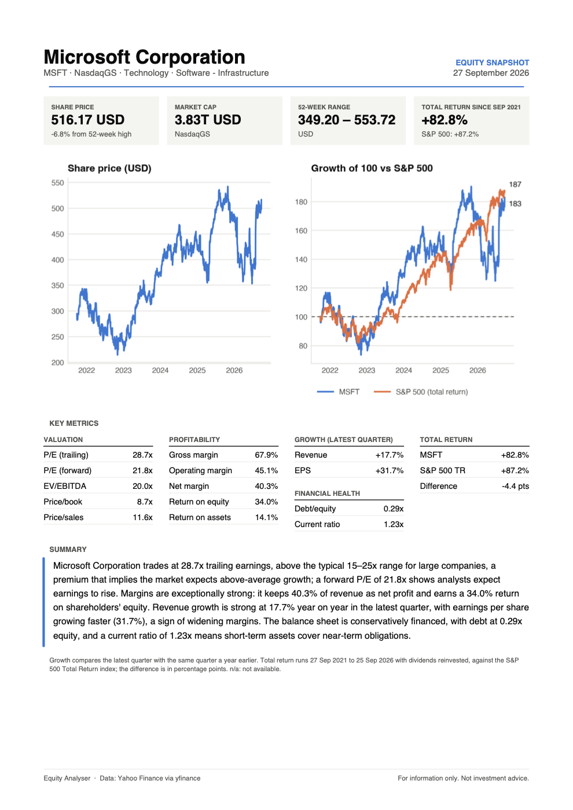

# Equity Analyser

A Python command-line tool that takes a stock ticker and produces a one-page equity snapshot: company overview, valuation, profitability, growth, financial health, five-year performance against the S&P 500, and a plain-English summary. Output goes to the terminal, a chart, and a client-style PDF report.

```bash
python main.py MSFT
```



The full PDF is in [`examples/MSFT_report.pdf`](examples/MSFT_report.pdf).

## Why I built this

This is a learning project. I'm interested in wealth management and private equity, and I wanted to understand the numbers behind a company snapshot by building the analysis myself instead of reading ratios off a website. That meant working out where each metric comes from, when it stops being meaningful (a bank has no gross margin; a loss-making company has no useful P/E), and how to compare a stock against the market fairly.

It was also a way to learn Python for financial analysis: pulling market data with `yfinance`, working with time series in `pandas`, charting with `matplotlib`, and generating reports with `reportlab`.

## What it produces

For any ticker Yahoo Finance covers (US and international):

| Section | Metrics |
|---|---|
| Company snapshot | Name, sector, industry, exchange, price, market cap |
| Valuation | P/E (trailing and forward), EV/EBITDA, price/book, price/sales |
| Profitability | Gross, operating and net margin; return on equity; return on assets |
| Growth | Revenue growth and EPS growth (latest quarter, year on year) |
| Financial health | Debt/equity, current ratio |
| Price context | 52-week high/low, distance from high, total return vs the S&P 500 |
| Summary | Four sentences on valuation, margins, growth and leverage |

Each run creates:

- a console report
- `charts/<TICKER>_price_context.png`: price history, and growth of 100 against the S&P 500
- `reports/<TICKER>_report.pdf`: the one-page A4 report

## How to run it

Requires Python 3.10 or later.

```bash
# 1. Get the code
git clone https://github.com/donnellycormac8/equity-analyser.git
cd equity-analyser

# 2. Create and activate a virtual environment
python3 -m venv .venv
source .venv/bin/activate        # Windows: .venv\Scripts\activate

# 3. Install dependencies
pip install -r requirements.txt

# 4. Run it
python main.py AAPL              # any Yahoo Finance ticker
python main.py RY.TO             # non-US listings use Yahoo's suffixes
python main.py MSFT --raw        # print every raw field Yahoo returns
```

With no ticker, it defaults to `AAPL`.

## Methodology

### Data

All data comes from Yahoo Finance through the [`yfinance`](https://github.com/ranaroussi/yfinance) library:

- **Fundamentals** come from `Ticker.info`, Yahoo's summary of about 180 fields per company.
- **Price history** comes from `Ticker.history(period="5y", auto_adjust=False)`, which returns two price columns:
  - `Close` is the price as quoted each day (adjusted for splits only). It's used for the price chart.
  - `Adj Close` is also adjusted for dividends. It's used for return calculations.

### Adjustments to the raw data

Yahoo's fields don't always mean what they appear to, so the tool corrects for the following:

- **Debt/equity** is reported by Yahoo as a percentage (29.1 means 0.29x). The tool divides it by 100.
- **Growth rates** from Yahoo compare the latest quarter with the same quarter a year earlier. They are labelled that way, not presented as annual growth.
- **Banks, insurers and similar businesses:** gross margin, debt/equity and current ratio are shown as *not applicable*. These firms have no cost of goods sold, and their balance sheets (deposits, policy reserves) are the business itself, so these ratios don't describe them. Excluded:
  - companies whose Yahoo industry starts with `Banks - `, `Insurance - `, `Mortgage Finance` or `Capital Markets`
  - any financial-services company with a gross margin of exactly zero, which is how Yahoo marks lenders sitting in mixed industries (for example, Capital One in "Credit Services" alongside Visa)
- **Negative multiples:** a negative P/E or EV/EBITDA is shown as *n/m* (not meaningful). It means earnings are negative, not that the stock is cheap.

### Performance vs the S&P 500

- **Total return on both sides.** The stock's dividend-adjusted price is compared with the **S&P 500 Total Return index** (`^SP500TR`), not the headline `^GSPC`, which excludes dividends and would understate the market by roughly 1.3–1.5% a year.
- **Matching dates.** The series are joined on dates both traded. For companies listed less than five years ago, the comparison starts at the IPO and covers the same period for the index.
- **Common scale.** Both series are rebased to 100 on the first shared day, and the difference is reported in percentage points.
- **Currency.** Non-USD stocks are converted to USD with Yahoo's exchange-rate tickers (`CAD=X`, `EUR=X`, `GBP=X`, …) before comparing, so the comparison isn't distorted by currency moves. The local-currency return is shown alongside.

### Summary thresholds

The written summary uses broad rules of thumb, defined as constants in `main.py`:

| Topic | Rule |
|---|---|
| Valuation | Trailing P/E vs a typical 15–25x range for large companies; falls back to price/sales for loss-makers |
| Margins | Net margin ≥ 20% exceptionally strong, ≥ 10% healthy, otherwise thin |
| Growth | Revenue growth ≥ 15% strong, ≥ 5% moderate; flags when EPS growth diverges from revenue by 5+ points |
| Leverage | Debt/equity < 0.5x conservative, < 1.5x moderate, otherwise high |

ROE is left out of the summary when above 100%, because that usually reflects equity shrunk by buybacks rather than exceptional returns.

## Limitations

- **Free, unofficial data.** `yfinance` is an open-source library that reads Yahoo Finance's public website. It is not affiliated with Yahoo, and it can break when Yahoo changes its site. Figures can be delayed, restated or occasionally wrong, and there is no guarantee of accuracy.
- **Not investment advice.** This is a learning project. Nothing it produces is a recommendation to buy or sell any security.
- **Market-wide thresholds.** The summary judges every company against the same rules of thumb. A 20x P/E means something different for a utility than for a software company, and a proper analysis would compare against sector peers.
- **Single-quarter growth.** Growth figures cover one quarter, which can be noisy or seasonal. Multi-year growth from annual statements would be more robust.
- **Heuristic handling of financials.** Classifying banks and insurers by Yahoo's industry label is approximate. Fee-based firms in "Capital Markets" lose metrics that would be meaningful for them, and hybrids such as American Express keep theirs.
- **Point-in-time snapshot.** Each report reflects the data on the day it was run.
- **Currency.** Only the S&P 500 comparison is converted to USD. Price, market cap and the 52-week range stay in the listing currency.

## Project structure

```
equity-analyser/
├── main.py              # data fetching, calculations, summary, chart and PDF
├── requirements.txt     # yfinance, pandas, matplotlib, reportlab
├── examples/
│   ├── MSFT_report.pdf          # sample output
│   └── MSFT_report_preview.png  # image of the sample, shown above
├── charts/              # generated charts (not tracked by git)
└── reports/             # generated PDFs (not tracked by git)
```
